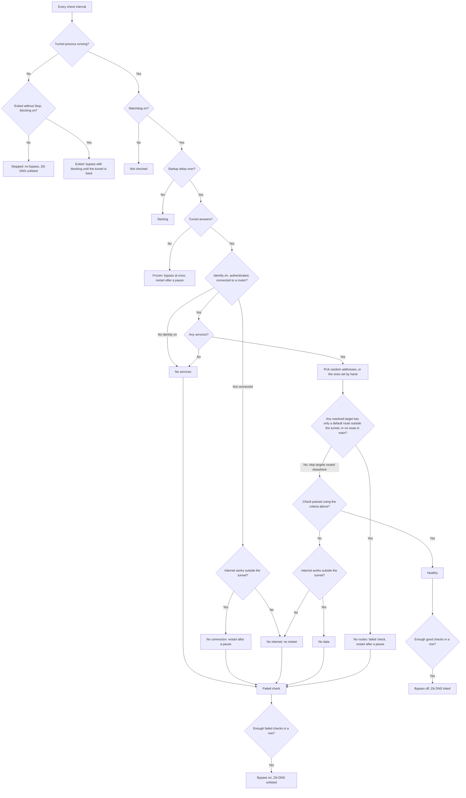
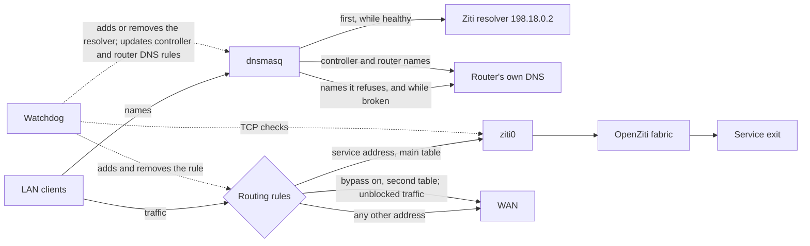

# openwrt-ziti-stack

Signed [OpenZiti](https://openziti.io) packages for OpenWrt 25.12. Install with `apk add`.

The upstream [ziti-openwrt](https://github.com/openziti/ziti-openwrt) project publishes `opkg` packages for OpenWrt 23.05. This repository builds the same software for the `apk` package manager used since OpenWrt 25.12.

## Why this project exists

OpenWrt 25.12 replaced `opkg` with `apk`. Using the upstream OpenZiti packages on this release requires rebuilding them with the OpenWrt SDK and applying compatibility fixes for each release.

This project:

- builds packages for the listed 25.12.x releases and publishes a signed feed for installation and updates with `apk`;
- fixes what stops the upstream packages from working on a clean 25.12 system: the libuv version, the missing `curl` dependency, and the `opkg` calls in the web interface;
- tests package installation, signature checks, and detection of modified packages in containers before publishing.

## What OpenZiti does on a router

[OpenZiti](https://openziti.io) is a zero-trust overlay network. It grants access to individual services using cryptographic identities and policies defined on your controller. The tunneler makes outbound connections, so the router needs no open inbound ports or public IP address.

Running the tunneler on a router gives you:

- **Access for devices that cannot run a tunneler.** Printers, TVs, phones, and guest devices behind the router can reach Ziti services without installing OpenZiti software.
- **LAN IPv4 traffic through a remote exit.** A travel router can send TCP and UDP traffic through an exit at home, so clients use the exit's public address.
- **An exit or entry point into a network.** The router can publish services from its own LAN to the overlay, again without opening ports.

OpenZiti carries TCP and UDP, not ICMP, so `ping` does not work through the tunnel. The tunneler runs in user space, so expect lower throughput than a kernel VPN.

## Packages

| Package | Purpose | When to install |
|---|---|---|
| `ziti-edge-tunnel` | The tunneler, its watchdog, and the firewall zone | Always |
| `llhttp9` | HTTP parser library | Pulled in automatically |
| `luci-app-ziti` | Web interface under Services > OpenZiti | Optional |

The device's role depends on service configurations and policies on your Ziti controller:

- **Exit point:** an identity with a Bind policy.
- **LAN gateway:** an identity with a Dial policy.
- **Both:** one identity with both policies, or two identities.

## Supported systems

Only official OpenWrt firmware is supported. Vendor firmware has different kernels, libraries, and package managers.

| Architecture | OpenWrt | Built | Installed in a container |
|---|---|---|---|
| `aarch64_cortex-a53` | 25.12.0 to 25.12.6 | Yes | Yes, in an `aarch64_generic` image |

Use the latest supported 25.12.x release for security fixes. Packages for older releases remain available for existing installations.

Container tests install packages without running installation scripts. They do not test a live tunnel, procd, ubus, or router networking.

### Router compatibility

These routers have official OpenWrt 25.12.6 images for `mediatek/filogic`, the build target used by this project. Check [the OpenWrt firmware selector](https://firmware-selector.openwrt.org/) for other models. Hardware specifications come from secondary sources and may vary by revision; check your device.

| Router | SoC | RAM | Tested on a live router |
|---|---|---|---|
| Cudy WR3000P v1 | MT7981B | 512 MB | Yes, OpenWrt 25.12.6 |
| Cudy WR3000P v1 (OpenWrt U-Boot layout) | MT7981B | 512 MB | Yes, same hardware as the WR3000P v1 |
| Cudy TR3000 v1 | MT7981B | 512 MB | Not yet; same SoC and RAM as the WR3000P |
| GL.iNet GL-MT3000 | MT7981B | 512 MB | Not yet; same SoC and RAM as the WR3000P |
| OpenWrt One | MT7981B | 1 GB | Not yet |
| Cudy WR3000E v1 | MT7981B | 256 MB | Not yet |
| Cudy WR3000H v1 | MT7981B | 256 MB | Not yet |
| ASUS TUF-AX4200 | MT7986 | 512 MB | Not yet |
| ASUS RT-AX59U | MT7986 | 512 MB | Not yet |
| Banana Pi BPI-R3 | MT7986 | 2 GB | Not yet |
| Banana Pi BPI-R4 | MT7988 | 4 GB | Not yet |

GL.iNet's own firmware is not supported, even on these models: use official OpenWrt. Other targets with the `aarch64_cortex-a53` architecture may work but have not been tried. A matching architecture does not prove that a specific device works, because kernel modules and hardware offload differ between targets.

## Install

The official OpenWrt repositories must stay enabled, because they supply the dependencies. `ziti-edge-tunnel` and its dependencies take about 9 MB of unpacked disk space, so check the free space on your router first.

With [`install.sh`](install.sh):

```sh
uclient-fetch -q -O - https://raw.githubusercontent.com/pipzic/openwrt-ziti-stack/master/install.sh | sh
```

If `curl` is installed, you can use it instead (OpenWrt does not include it by default):

```sh
curl -fsSL https://raw.githubusercontent.com/pipzic/openwrt-ziti-stack/master/install.sh | sh
```

This installs `ziti-edge-tunnel`. To choose the packages, pass them as arguments:

```sh
uclient-fetch -q -O - https://raw.githubusercontent.com/pipzic/openwrt-ziti-stack/master/install.sh | sh -s -- ziti-edge-tunnel luci-app-ziti
```

To review the script before running it, download it and read it before passing it to `sh`.

Or paste the same steps over SSH:

```sh
(
  set -e
  . /etc/openwrt_release
  ARCH=$(head -n 1 /etc/apk/arch)
  FEED=https://pipzic.github.io/openwrt-ziti-stack
  REPO="$FEED/$DISTRIB_RELEASE/$ARCH/packages.adb"
  uclient-fetch -q -O /dev/null "$REPO"          # stops here on an unsupported release or architecture
  uclient-fetch -q -O /tmp/openwrt-ziti-stack.pem "$FEED/openwrt-ziti-stack.pem"
  echo "a479efa32458cbd16fba98ed2b0dc2d921329312490729739a04f6531d56ceae  /tmp/openwrt-ziti-stack.pem" | sha256sum -c -
  mkdir -p /etc/apk/keys /etc/apk/repositories.d
  mv /tmp/openwrt-ziti-stack.pem /etc/apk/keys/
  echo "$REPO" > /etc/apk/repositories.d/openwrt-ziti-stack.list
  apk update
  apk add ziti-edge-tunnel                       # optional: luci-app-ziti
)
```

## Enroll an identity

Create an identity on your Ziti controller and download its enrollment token (a `.jwt` file).

Use Services > OpenZiti > Identities in the web interface (requires `luci-app-ziti`), or copy the token to `/tmp/device.jwt` on the router and run:

```sh
ziti-edge-tunnel enroll --jwt /tmp/device.jwt --identity /etc/ziti/identities/device.json
chmod 600 /etc/ziti/identities/device.json
rm /tmp/device.jwt
/etc/init.d/ziti-edge-tunnel restart
```

## How it behaves

The tunneler loads all enabled identities. Their service intercept configurations determine which traffic enters the tunnel. Enable or disable an identity under Services > OpenZiti > Identities.

A service that should carry all IPv4 traffic must intercept `0.0.0.0/1` and `128.0.0.0/1`. An intercept of `0.0.0.0/0` does not work on a router: the tunneler cannot add a second default route.

**A full tunnel breaks port forwards.** With `0.0.0.0/1` and `128.0.0.0/1` in the tunnel, replies from LAN servers to internet clients follow the tunnel unless a more specific route takes them elsewhere. Connections forwarded from WAN to the LAN then fail because replies do not return through WAN. Connection tracking does not automatically select the return path. For the same reason, do not use a full tunnel if your Ziti controller or routers sit behind this router: their internet traffic follows the tunnel too. The package does not add routing exceptions for these hosts.

**On tunnel failure,** the watchdog enables bypass while leaving the tunnel running so it can reconnect. Routing through the tunnel resumes after the configured number of successful checks. The watchdog restarts the tunnel only if it stops responding or remains disconnected despite working internet access. It does not start a tunnel you stopped manually. After a reboot, the autostart setting determines whether the tunnel starts.

During bypass, traffic follows the router's normal routes and uses its normal public address. To block traffic to service addresses and names instead, enable **Block services on failure** in the settings. Blocking also applies if the tunnel process exits unexpectedly, until procd restarts it and the checks pass. Selecting **Stop** removes the blocking.

The tunnel's routes disappear when its process exits. The watchdog notices on a later check; checks and other work can make this take longer than one interval. With the watchdog and blocking enabled, once service prefixes have been cached, the watchdog installs two rules for each source-zone device and cached non-default service prefix. It also adds a pair for `198.18.0.0/16`. These rules remain while the tunnel is started and has not been stopped. The first rule uses the main table only if its matching route is at least as specific as the protected prefix. The second rejects traffic that did not find such a route. Once installed, the rules prevent traffic from falling back to a less specific route when the tunnel exits. Equally specific or more specific routes outside the tunnel still work. The router's own traffic is not affected.

**By default, the watchdog checks the OpenZiti network rather than service availability.** Each check randomly selects up to the configured number of addresses from enabled identities' services. It resolves any selected hostnames and starts TCP connection attempts through the tunnel in parallel. A successful connection ends the check and cancels the remaining attempts. If no connection succeeds, certain failure messages in the tunneler log also count as a response from OpenZiti:

| Connection result | Automatic check | Custom resources |
|---|---|---|
| Connected | Passes | Passes |
| Target refused the connection, no service terminators, or a route-creation error reported for a dial | Passes if a new matching failure appears in the tunneler log | Does not count |
| No answer | Does not count | Does not count |

An unavailable service can therefore leave the tunnel marked healthy while connections to that service fail. This also applies to an exit service carrying all intercepted traffic. To require a successful TCP connection, list resources under **Check specific resources**. Each check samples only that list, up to the configured address count, and fails if none of the selected resources accepts a connection.

Each unique address-and-port pair has the same chance of selection. Hostnames are resolved when selected. For an IPv4 subnet, the probe uses the listed address plus one where possible, such as `128.0.0.1` for `128.0.0.0/1`; `/31` and `/32` addresses are used unchanged. Wildcard names, IPv6 addresses, and UDP-only services are excluded from automatic probes. If no probe targets are available, the watchdog relies on authentication and router connection status.

The TCP probes are bound to `ziti0`, so they can reach the tunnel even when its route is missing from the main table. Before starting the connections, the watchdog checks the longest matching IPv4 prefix in the main table for each resolved target. If any target has only a default route outside the tunnel, or no matching route, the check returns "Tunnel routes missing". The watchdog schedules a restart after the configured pause to reload the routes. Targets with a more specific route outside the tunnel, such as a LAN subnet, are skipped. If at least one target is skipped and none remain to probe, the traffic check passes, including for custom resources. This examines the main table only; it does not evaluate other policy routing rules.

To see what it would check, run `/usr/libexec/ziti-boot-guard probes`.



How the parts fit together:



### DNS

The package preserves your DNS servers: those supplied by your provider, configured on the WAN interface, or listed under Network > DHCP and DNS > Forwards. It places the OpenZiti resolver first in dnsmasq's server list:

- While the tunnel is healthy, dnsmasq sends queries without a more specific forwarding rule to OpenZiti first. OpenZiti resolves service names and refuses other queries, which dnsmasq then sends to your DNS servers.
- While the tunnel is broken, OpenZiti is taken out of the list, and dnsmasq asks only your own servers.
- The watchdog adds DNS forwarding rules for controller and router names using your existing DNS servers. This prevents a broad service intercept, such as `*.org`, from resolving the tunnel's own endpoints to addresses inside the tunnel. Existing domain rules, such as `/example.org/192.168.1.53`, determine which servers these rules use. If no upstream server is available for a name, the watchdog cannot add a rule for it.

The watchdog keeps the rules for the controller and router names up to date. It rewrites them when you change your DNS servers, when your provider hands out new ones, or when a new controller or router appears.

A DNS server that is reachable only through the tunnel works like any other address of a service: add a forwarding rule for its domain under Forwards, and make sure a service intercepts its address. It answers only while the tunnel is healthy.

> [!IMPORTANT]
> **This project overrides the tunneler's DNS range.** By default the tunneler gives service names addresses from `100.64.0.0/10`. dnsmasq rebind protection, on by default in OpenWrt, drops those answers, as it does for `10.0.0.0/8`, so service names would work only with that protection turned off. Answers from `198.18.0.0/16` pass it (tested with dnsmasq 2.93). The package therefore starts the tunneler with `--dns-ip-range 198.18.0.1/16`, and the protection stays on.
>
> The range is fixed and is not a setting. Do not use this package on a network that already uses `198.18.0.0/16`.

### Settings

Set these in the web interface under Services > OpenZiti > Settings, or with `uci` in `/etc/config/ziti`. The web interface folds the rarely changed ones into **Additional watchdog settings**. Changes apply without restarting the tunnel.

| Option | Default | Meaning |
|---|---|---|
| `log_level` | `INFO` | Log detail level |
| `source_zones` | `lan` | Firewall zones whose traffic may enter the tunnel |
| `watchdog_enabled` | `1` | Check the tunnel and send traffic around it on failure |
| `block_on_failure` | `0` | During bypass, block traffic to cached service addresses and names. With the watchdog on, installed rules also prevent source-zone traffic to cached non-default service prefixes from falling back to less specific routes after an unexpected process exit |
| `watchdog_probes` | none | Resources that must accept a connection, as `address[:port]` or `name[:port]`, port 443 if omitted |
| `watchdog_interval` | `5` | Seconds between checks |
| `watchdog_fails` | `3` | Consecutive failed checks before bypass; an unresponsive tunnel triggers bypass immediately |
| `watchdog_recover` | `2` | Consecutive successful checks before restoring tunnel routing |
| `watchdog_timeout` | `12` | Seconds to wait for one address. The fabric reports a failed connection after about 10 seconds, so keep it at 11 or more |
| `watchdog_grace` | `15` | Seconds before the first check after a start |
| `watchdog_probe_count` | `3` | Maximum addresses sampled per check, from services or the custom resource list |
| `watchdog_wan_probes` | `1.1.1.1 8.8.8.8 9.9.9.9 208.67.222.222` | Addresses checked outside the tunnel to distinguish an internet outage from an OpenZiti network failure |
| `watchdog_restart_delays` | `30 120 600 1800` | Seconds before each restart; the last one repeats |
| `watchdog_status_timeout` | `4` | Timeout in seconds for each tunnel status request; a failed request or timeout marks the tunnel as unresponsive |
| `watchdog_wan_timeout` | `3` | Seconds to wait for one internet check address |
| `watchdog_dns_timeout` | `3` | Seconds to wait for a DNS answer |
| `bypass_table` | `1890` | Routing table of the bypass |
| `bypass_priority` | `100` | Priority of the rule that selects the bypass table. Blocking rules use this value plus 1 and 2 |

To check that a full tunnel can reach a public resource through its exit, add a target under **Check specific resources**, for example `1.1.1.1:443`. If the TCP connection fails for the configured number of checks, the watchdog enables bypass. This checks connectivity, not the exit's public IP address.

### Fixed values

These are set in the code and cannot be changed in the settings:

- **Addresses for service names:** `198.18.0.0/16`, with the OpenZiti resolver at `198.18.0.2`. If your network already uses this range, its addresses clash with service names.
- **dnsmasq instance:** the package changes the first dnsmasq instance (`dhcp.@dnsmasq[0]`) and puts its rules into the configuration directory of the first one it finds. With several instances, the two may not be the same one.

## What this changes on your router

**Adds:**

| What | Where |
|---|---|
| The tunneler, the watchdog, two services | `/usr/bin/ziti-edge-tunnel`, `/usr/libexec/ziti-boot-guard`, `/etc/init.d/ziti-edge-tunnel`, `/etc/init.d/ziti-guard`, and their `/etc/rc.d` links |
| Settings and identities | `/etc/config/ziti`, `/etc/ziti/identities/` |
| Saved state | `/etc/ziti/dns.saved` (your original `strictorder`), `/etc/ziti/service-names` and `/etc/ziti/service-prefixes` (for blocking), `/var/run/ziti-*` (including the token while Enroll runs) |
| Firewall zone `ziti` | Device `ziti0`, input and forward rejected, output accepted, masquerading and MSS clamping on |
| Firewall forwardings | From each zone in `source_zones` to `ziti`, named `ziti_fwd_<zone>`. Existing user-created forwardings are preserved |
| System group `ziti` | `/etc/group`, for the tunneler's control socket |
| Dependencies | `curl`, `ip-full`, `kmod-tun`, and the libraries `apk` pulls in |
| Web interface, with `luci-app-ziti` | Views under `/www/luci-static/resources/view/ziti/`, `/usr/libexec/rpcd/ziti`, its ACL and menu entry, the Russian translation |
| Feed, with `install.sh` | `/etc/apk/keys/openwrt-ziti-stack.pem`, `/etc/apk/repositories.d/openwrt-ziti-stack.list` |

**Changes:**

| What | How |
|---|---|
| dnsmasq `strictorder` | Set to `1`, so dnsmasq asks OpenZiti before your own servers |
| dnsmasq `server` list | Gains `198.18.0.2` at the top while the tunnel is healthy. Your entries keep their order. dnsmasq restarts when this changes |

**While running:**

| What | When |
|---|---|
| Interface `ziti0`, and a route in the main table for each service | While the tunnel runs |
| `ziti-fabric.conf` in dnsmasq's configuration directory, with the rules for the controller and router names | While the watchdog runs |
| Two routing rules per address family at priority `100`, and table `1890` | While bypass is enabled. The first rule lets the watchdog's own checks reach the tunnel |
| `ziti-block.conf` in dnsmasq's configuration directory | While traffic goes around the tunnel, with **Block services on failure** ticked |
| Routing rules at `bypass_priority + 1` and `bypass_priority + 2` (`101` and `102` by default), two per source-zone device and cached non-default service prefix, plus a pair for `198.18.0.0/16` | Installed by the watchdog once service prefixes are cached, with the watchdog on, **Block services on failure** enabled, at least one identity present, and the tunnel started without Stop |

**Leaves alone:** your DNS servers, rebind protection, `/etc/hosts`, forwardings into `ziti` that you made yourself, the `lan` to `wan` forwarding, WAN and wireless settings. The package removes none of your settings.

**After `apk del`:** the bypass and blocking rules, the bypass tables, package-managed firewall sections, and dnsmasq changes are removed, and your original `strictorder` value is restored. Identities and modified settings remain for later reinstallation, as does the `ziti` group. Remove the key and feed list as shown under [Remove](#remove).

## Update the packages

```sh
apk update
apk add --upgrade ziti-edge-tunnel luci-app-ziti
```

Leave out `luci-app-ziti` if you do not use the web interface.

## After a system upgrade

`sysupgrade` replaces the installed packages. Whether the signing key and the feed list survive depends on how you upgrade. Run the install snippet again for the new release, then install the same optional packages. Identities and settings under `/etc` are kept by a normal keep-settings upgrade.

Attended Sysupgrade and `owut` do not carry packages from third-party feeds into the new image. Reinstall these packages for the new release after the upgrade.

## Remove

```sh
apk del luci-app-ziti ziti-edge-tunnel
rm /etc/apk/repositories.d/openwrt-ziti-stack.list /etc/apk/keys/openwrt-ziti-stack.pem
```

## Differences from upstream

- Built for OpenWrt 25.12 and `apk`, from a copy of upstream commit `f54a5d7` kept in this repository.
- `ziti-edge-tunnel` 1.18.7, with a guard for libuv older than 1.50, because OpenWrt 25.12 ships 1.48.
- `ziti-edge-tunnel` depends on `curl`, which the watchdog uses for its checks.
- The web interface's update check uses `apk`.
- The full and split modes are gone, and a new watchdog keeps the tunnel running through failures.
- The tunneler gives service names addresses from `198.18.0.0/16` instead of `100.64.0.0/10`, so rebind protection stays on.
- dnsmasq asks OpenZiti first for queries without a more specific forwarding rule, then uses the router's own DNS servers. The watchdog adds separate forwarding rules for controller and router names.
- Identities can be turned on and off, and their names and state come from the tunnel.
- The firewall zone is created on installation.
- The web interface includes a Russian translation.

The modified packages are in [`packages/`](packages/).

## Trust model

Each package index is signed with this project's key, and `apk` checks that signature and the package hashes it contains. The private key is used only by the signing job. The public key is in [`keys/`](keys/), and its SHA-256 is in the snippet above.

A valid signature only shows that this repository published the package. It does not show that the code is safe. The package recipes, web interface, and scripts are in this repository. The tunneler source is pinned by hash, except for `ziti-sdk-c`, which its build fetches by tag.

GitHub Actions builds every package from this repository with the OpenWrt SDK, verified against OpenWrt's signed checksums. See [the workflow](.github/workflows/build.yml).

## License

[Apache License 2.0](LICENSE). See [NOTICE](NOTICE) for third-party software.
