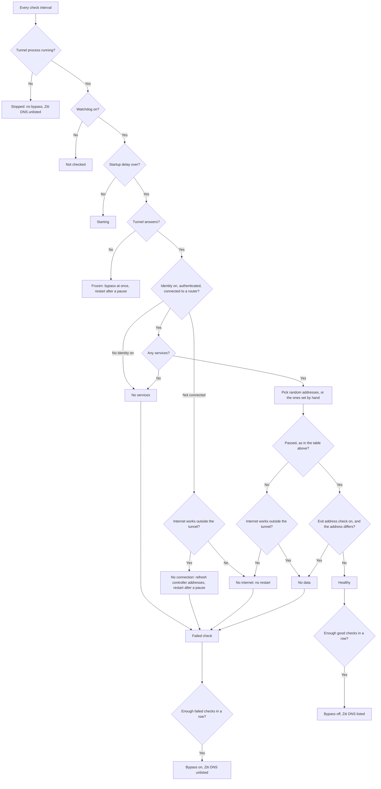
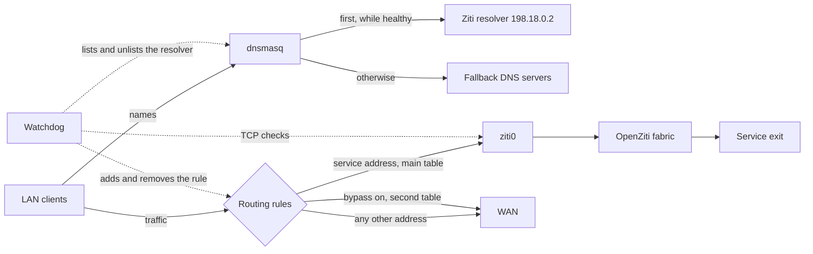

# openwrt-ziti-stack

Signed [OpenZiti](https://openziti.io) packages for OpenWrt 25.12, installable with a plain `apk add`.

The upstream [ziti-openwrt](https://github.com/openziti/ziti-openwrt) project publishes `opkg` packages for OpenWrt 23.05. This repository builds the same software for the `apk` package manager used since OpenWrt 25.12.

## Why this project exists

OpenWrt 25.12 replaced `opkg` with `apk`, and no ready-made OpenZiti packages exist for it. Without them you need to set up the OpenWrt SDK, patch the sources, and repeat that for every release.

This project solves that:

- builds the packages for every 25.12.x release and publishes them as a signed feed, so installing and updating take one `apk` command;
- fixes what stops the upstream packages from working on a clean 25.12 system: the libuv version, the missing `curl` dependency, and the `opkg` calls in the web interface;
- tests every release before publishing.

## What OpenZiti does on a router

[OpenZiti](https://openziti.io) is a zero-trust overlay network: access goes to named services rather than to a network, each device has its own cryptographic identity, and policies on your controller decide who may reach what. Connections are outbound, so the router needs no open inbound ports or public IP address.

Running the tunneler on a router gives you:

- **Access for devices that cannot run a tunneler.** Printers, TVs, phones, and guests behind the router reach Ziti services without any software of their own.
- **All LAN traffic through a remote exit.** A travel router can send everything through an exit at home, so clients appear to be at that location.
- **An exit or entry point into a network.** The router can publish services from its own LAN to the overlay, again without opening ports.

OpenZiti carries TCP and UDP, not ICMP, so `ping` does not work through the tunnel. The tunneler runs in user space, so expect lower throughput than a kernel VPN.

## Packages

| Package | Purpose | When to install |
|---|---|---|
| `ziti-edge-tunnel` | The tunneler, its watchdog, and the firewall zone | Always |
| `llhttp9` | HTTP parser library | Pulled in automatically |
| `luci-app-ziti` | Web interface under Services > OpenZiti | Optional |

The device's role is decided by the service policies on your Ziti controller, not by the packages:

- **Exit point:** an identity with a Bind policy.
- **LAN gateway:** an identity with a Dial policy.
- **Both:** one identity with both policies, or two identities.

## Supported systems

Only official OpenWrt firmware is supported. Vendor firmware has different kernels, libraries, and package managers.

| Architecture | OpenWrt | Built | Installed and started in a container |
|---|---|---|---|
| `aarch64_cortex-a53` | 25.12.0 to 25.12.6 | Yes | Yes, in an `aarch64_generic` image |

Use the latest 25.12.x: older releases are available for existing installations, but newer ones carry security fixes.

### Router compatibility

These routers have official OpenWrt 25.12.6 images on the `mediatek/filogic` target, the target these packages are built on. The list is not complete: check [the OpenWrt firmware selector](https://firmware-selector.openwrt.org/) for your model. Hardware figures come from secondary sources and may differ between revisions, so check your unit.

| Router | SoC | RAM | Tested on a live router |
|---|---|---|---|
| Cudy WR3000P v1 | MT7981B | 512 MB | Not yet |
| Cudy TR3000 v1 | MT7981B | 512 MB | Not yet; same SoC and RAM as the WR3000P |
| GL.iNet GL-MT3000 | MT7981B | 512 MB | Not yet; same SoC and RAM as the WR3000P |
| OpenWrt One | MT7981B | 1 GB | Not yet |
| Cudy WR3000E v1 | MT7981B | 256 MB | Not yet |
| Cudy WR3000H v1 | MT7981B | 256 MB | Not yet |
| ASUS TUF-AX4200 | MT7986 | 512 MB | Not yet |
| ASUS RT-AX59U | MT7986 | 512 MB | Not yet |
| Banana Pi BPI-R3 | MT7986 | 2 GB | Not yet |
| Banana Pi BPI-R4 | MT7988 | 4 GB | Not yet |

GL.iNet's own firmware is not supported, even on these models: use official OpenWrt. Other targets with the `aarch64_cortex-a53` architecture may work but have not been tried. A matching architecture does not prove that a specific device works, because kernel modules and hardware offload differ between targets.

## Install

The official OpenWrt repositories must stay enabled, because they supply the dependencies. `ziti-edge-tunnel` and its dependencies take about 9 MB of unpacked disk space, so check the free space on your router first.

With [`install.sh`](install.sh):

```sh
uclient-fetch -q -O - https://raw.githubusercontent.com/pipzic/openwrt-ziti-stack/master/install.sh | sh
```

If `curl` is installed, this does the same job (OpenWrt does not ship it by default):

```sh
curl -fsSL https://raw.githubusercontent.com/pipzic/openwrt-ziti-stack/master/install.sh | sh
```

This installs `ziti-edge-tunnel`. To choose the packages, pass them as arguments:

```sh
uclient-fetch -q -O - https://raw.githubusercontent.com/pipzic/openwrt-ziti-stack/master/install.sh | sh -s -- ziti-edge-tunnel luci-app-ziti
```

Piping to `sh` runs whatever the URL serves, so read the script first if you prefer.

Or paste the same steps over SSH:

```sh
(
  set -e
  . /etc/openwrt_release
  ARCH=$(head -n 1 /etc/apk/arch)
  FEED=https://pipzic.github.io/openwrt-ziti-stack
  REPO="$FEED/$DISTRIB_RELEASE/$ARCH/packages.adb"
  uclient-fetch -q -O /dev/null "$REPO"          # stops here on an unsupported release or architecture
  uclient-fetch -q -O /tmp/openwrt-ziti-stack.pem "$FEED/openwrt-ziti-stack.pem"
  echo "a479efa32458cbd16fba98ed2b0dc2d921329312490729739a04f6531d56ceae  /tmp/openwrt-ziti-stack.pem" | sha256sum -c -
  mkdir -p /etc/apk/keys /etc/apk/repositories.d
  mv /tmp/openwrt-ziti-stack.pem /etc/apk/keys/
  echo "$REPO" > /etc/apk/repositories.d/openwrt-ziti-stack.list
  apk update
  apk add ziti-edge-tunnel                       # optional: luci-app-ziti
)
```

## Enroll an identity

Create an identity on your Ziti controller and download its enrollment token (a `.jwt` file).

Then use the web interface (Services > OpenZiti > Identities, needs `luci-app-ziti`), or copy the token to `/tmp/device.jwt` on the router and run:

```sh
ziti-edge-tunnel enroll --jwt /tmp/device.jwt --identity /etc/ziti/identities/device.json
chmod 600 /etc/ziti/identities/device.json
rm /tmp/device.jwt
/etc/init.d/ziti-edge-tunnel restart
```

## How it behaves

All enabled identities work at once, and their services decide what enters the tunnel. There are no modes. Turn an identity on or off under Services > OpenZiti > Identities.

A service that should carry all traffic must intercept `0.0.0.0/1` and `128.0.0.0/1`. An intercept of `0.0.0.0/0` does not work on a router: the tunneler cannot add a second default route.

Do not send all traffic through the tunnel if your Ziti controller or routers sit behind this router: their own traffic enters the tunnel too.

**When the tunnel breaks,** a watchdog sends traffic around it and leaves it running, so remote access returns on its own as soon as the overlay does. It restarts the tunnel only if it stops responding or stays disconnected while the internet works. It does not start a tunnel you stopped yourself; after a reboot, the autostart setting decides.

While traffic goes around the tunnel, it goes directly, from your real address. To block the addresses and names of your services instead, tick **Block services on failure** in the settings.

**The watchdog checks the fabric, not your services.** Each check picks a few random addresses from all your services, a new choice every time, and opens TCP connections to them through the tunnel. One answer from the fabric is enough:

| Result of a connection | Automatic check | Resources set by hand |
|---|---|---|
| Connected | Passes | Passes |
| The target refused, or the service has no terminators | Passes: the fabric carried the request | Does not count |
| No answer | Does not count | Does not count |

So a dead service alone does not send traffic around the tunnel, and its traffic fails until the service returns. That includes an exit service carrying all your traffic. If a specific resource must work, list it under **Check specific resources**: the watchdog then connects only to those addresses, and goes around the tunnel when none of them answers.

All service addresses count the same. Names are resolved when picked, and a subnet is checked at its first address, such as `128.0.0.1` for `128.0.0.0/1`. Wildcard names and UDP-only services cannot be checked. If nothing can be checked, the watchdog relies on the connection to the controller and routers.

To see what it would check, run `/usr/libexec/ziti-boot-guard probes`.



How the parts fit together:



### DNS

dnsmasq asks OpenZiti first, so service names work without further setup, and falls back to other servers while the tunnel is broken.

> [!IMPORTANT]
> **This project overrides the tunneler's DNS range.** By default the tunneler gives service names addresses from `100.64.0.0/10`. dnsmasq rebind protection, on by default in OpenWrt, drops those answers, as it does for `10.0.0.0/8`, so service names would work only with that protection turned off. Answers from `198.18.0.0/16` pass it (tested with dnsmasq 2.93). The package therefore starts the tunneler with `--dns-ip-range 198.18.0.1/16`, and the protection stays on.
>
> The range is fixed and is not a setting. Do not use this package on a network that already uses `198.18.0.0/16`.

### Settings

Set these in the web interface under Services > OpenZiti > Settings, or with `uci` in `/etc/config/ziti`. The web interface folds the rarely changed ones into **Additional watchdog settings**. Changes apply without a restart, except `dns_upstream`.

| Option | Default | Meaning |
|---|---|---|
| `log_level` | `INFO` | Log detail for the tunnel |
| `watchdog_enabled` | `1` | Check the tunnel and send traffic around it on failure |
| `block_on_failure` | `0` | While broken, block service addresses and names instead |
| `watchdog_probes` | none | Resources that must really answer, as `address[:port]` or `name[:port]`, port 443 if omitted |
| `verify_expect_ip` | none | A check passes only if traffic leaves from this public IP |
| `watchdog_interval` | `10` | Seconds between checks |
| `watchdog_fails` | `3` | Failed checks in a row before traffic goes around the tunnel |
| `watchdog_recover` | `2` | Good checks in a row before traffic returns |
| `watchdog_timeout` | `12` | Seconds to wait for one address. The fabric reports a failed connection after about 10 seconds, so keep it at 11 or more |
| `watchdog_grace` | `20` | Seconds before the first check after a start |
| `watchdog_probe_count` | `3` | Random addresses tried per check |
| `watchdog_wan_probes` | `1.1.1.1 8.8.8.8 9.9.9.9 208.67.222.222` | Checked outside the tunnel, to tell a lost internet connection from a fabric failure |
| `watchdog_restart_delays` | `60 300 900 1800` | Seconds before each restart; the last one repeats |
| `watchdog_status_timeout` | `4` | Seconds to wait for the tunnel's state before calling it frozen |
| `watchdog_wan_timeout` | `4` | Seconds to wait for one internet check address |
| `watchdog_dns_timeout` | `5` | Seconds to wait for a DNS answer |
| `verify_url` | `https://api.ipify.org` | Service that reports the public IP for `verify_expect_ip` |
| `verify_timeout` | `8` | Seconds to wait for that service |
| `bypass_table` | `1890` | Routing table of the bypass |
| `bypass_priority` | `100` | Priority of the rule that selects it |
| `dns_fallback_servers` | `1.1.1.1 8.8.8.8` | dnsmasq asks these when OpenZiti has no answer or the tunnel is broken |
| `dns_upstream` | `1.1.1.1` | Where the tunnel's DNS sends names that are not services; `none` refuses them |

> [!IMPORTANT]
> **The host in `verify_url` must be part of a service of your identity.** The exit address check connects through the tunnel, so with any other host it fails and traffic goes around the tunnel.
>
> The router then sends that host into the tunnel for every device on your network, not only for the check. A dynamic DNS client or other software that uses the same host to find your public address gets the exit address instead, and may publish it. Do not use a host that anything on your network relies on for this.

## What this changes on your router

**Adds:**

| What | Where |
|---|---|
| The tunneler, the watchdog, two services | `/usr/bin/ziti-edge-tunnel`, `/usr/libexec/ziti-boot-guard`, `/etc/init.d/ziti-edge-tunnel`, `/etc/init.d/ziti-guard`, and their `/etc/rc.d` links |
| Settings and identities | `/etc/config/ziti`, `/etc/ziti/identities/` |
| Saved state | `/etc/ziti/dns.saved` and `/etc/ziti/dns.saved.servers` (original dnsmasq values), `/etc/ziti/service-names` (for blocking), `/var/run/ziti-*` |
| Firewall zone `ziti` | Device `ziti0`, input and forward rejected, output accepted, masquerading and MSS clamping on |
| Firewall forwarding | `lan` to `ziti` |
| System group `ziti` | `/etc/group`, for the tunneler's control socket |
| Dependencies | `curl`, `ip-full`, `kmod-tun`, and the libraries `apk` pulls in |
| Web interface, with `luci-app-ziti` | Views under `/www/luci-static/resources/view/ziti/`, `/usr/libexec/rpcd/ziti`, its ACL and menu entry, the Russian translation |
| Feed, with `install.sh` | `/etc/apk/keys/openwrt-ziti-stack.pem`, `/etc/apk/repositories.d/openwrt-ziti-stack.list` |

**Changes:**

| What | How |
|---|---|
| dnsmasq `noresolv` and `strictorder` | Both set to `1`, so dnsmasq ignores your provider's DNS servers and asks its own list in order |
| dnsmasq `server` list | Gains the fallback servers, plus `198.18.0.2` while the tunnel is healthy. dnsmasq restarts when this changes |
| `/etc/hosts` | A managed block with the controller's addresses, so the tunnel can find it whatever happens to DNS |

**While running:**

| What | When |
|---|---|
| Interface `ziti0`, and a route in the main table for each service | While the tunnel runs |
| Routing rule at priority `100`, and table `1890` | While traffic goes around the tunnel |
| `ziti-block.conf` in dnsmasq's configuration directory | While traffic goes around the tunnel, with **Block services on failure** ticked |

**Leaves alone:** rebind protection, the `lan` to `wan` forwarding, WAN and wireless settings. The package removes none of your settings. An upgrade from an older release of this package drops only that release's own settings.

**After `apk del`:** the watchdog, the rule, the `/etc/hosts` block, the firewall sections it created, and its dnsmasq changes are gone, with the original dnsmasq values restored. Identities and changed settings stay, so a later installation picks them up. So does the `ziti` group. Remove the key and the feed list as shown under [Remove](#remove).

## Update the packages

```sh
apk update
apk upgrade
```

`apk upgrade` updates every installed package, including those from the official repositories.

## After a system upgrade

`sysupgrade` replaces the installed packages. Whether the signing key and the feed list survive depends on how you upgrade. Run the install snippet again for the new release, then install the same optional packages. Identities and settings under `/etc` are kept by a normal keep-settings upgrade.

Attended Sysupgrade and `owut` do not carry packages from third-party feeds into the new image.

## Remove

```sh
apk del luci-app-ziti ziti-edge-tunnel
rm /etc/apk/repositories.d/openwrt-ziti-stack.list /etc/apk/keys/openwrt-ziti-stack.pem
```

## Differences from upstream

- Built for OpenWrt 25.12 and `apk`, from a copy of upstream commit `f54a5d7` kept in this repository.
- `ziti-edge-tunnel` 1.18.7, with a guard for libuv older than 1.50, because OpenWrt 25.12 ships 1.48.
- `ziti-edge-tunnel` depends on `curl`. The boot guard needs it, and without it the watchdog treats a healthy full tunnel as dead.
- The web interface's update check uses `apk`.
- The full and split modes are gone, and a new watchdog keeps the tunnel running through failures.
- The tunneler gives service names addresses from `198.18.0.0/16` instead of `100.64.0.0/10`, so rebind protection stays on.
- All DNS goes through OpenZiti first, with fallback servers. `ZET DNS upstream` defaults to `1.1.1.1`.
- Identities can be turned on and off, and their names and state come from the tunnel.
- The firewall zone is created on installation.
- The web interface includes a Russian translation.

The modified packages are in [`packages/`](packages/).

## Trust model

Each package index is signed with this project's key, and `apk` checks that signature and the package hashes it contains. The private key is used only by the signing job. The public key is in [`keys/`](keys/), and its SHA-256 is in the snippet above.

A valid signature only shows that this repository published the package. It does not show that the code is safe. The package recipes, web interface, and scripts are in this repository. The tunneler source is pinned by hash, except for `ziti-sdk-c`, which its build fetches by tag.

GitHub Actions builds every package from this repository with the OpenWrt SDK, verified against OpenWrt's signed checksums. See [the workflow](.github/workflows/build.yml).

## License

[Apache License 2.0](LICENSE). See [NOTICE](NOTICE) for third-party software.
